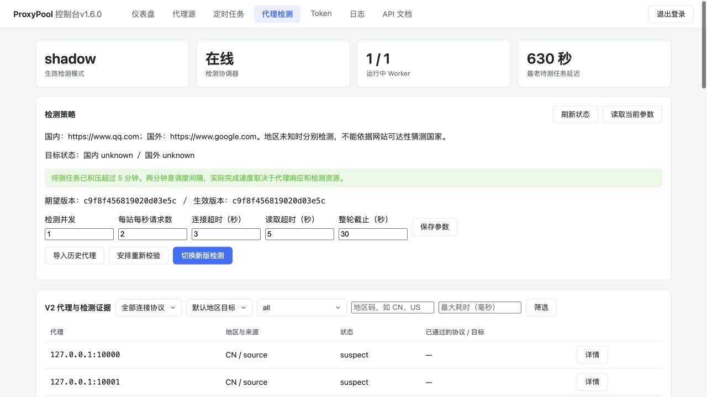

# 代理检测 V2 验收记录

开始日期：2026-11-19（Asia/Shanghai）。本报告区分本地受控验收、公网抽测和生产切换；抓取量不等于可用量，shadow 不等于 active。

## 受测代码与环境

- 业务代码冻结于 `79ea9d0ee9213c8e9a4eb0c21570eb6e4c7e068f`，分支 `feat/validation-v2`。后续仅补充报告与发布元数据时，应再次比较实际业务文件摘要。
- 本机 Python 3.13.13，使用 xiangmu；运行镜像 Python 3.13.18、Node 26.13.1 构建前端，测试 Redis 8.10.3。
- 本地应用、测试 Redis、故障恢复 Redis 使用隔离容器；测试不清空共享 Redis，不操作生产数据卷。应用只绑定回环端口。
- 最终本机回归（含覆盖率采集）：**622 项通过，29.48 秒**；Docker Python 3.13.18：**622 项通过，20.07 秒**，均包括真实 Redis 集成，无跳过。
- GitHub Tests 运行 `44565204751`：Python 3.10、3.11、3.12、3.13 全部成功。
- 本地 arm64 应用镜像 `sha256:986f927bd086fd3a5f4254b8d8793a0390bd2594dae5c2a15327df81354c9ea1`；OCI revision 与冻结提交一致，129 个业务、测试、前端与依赖文件 SHA-256 逐一相同。最终资源结果见下文及脱敏 JSON 摘要。

## 已完成的实际链路

1. HTTP CONNECT、TLS 代理、SOCKS4/4a/5/5h 均访问真实本地 TLS 目标；同时验证 DNS 解析发生侧、代理认证、两层证书校验及目标不收到代理认证头。
2. SOCKS5/5h 通过 IPv6 回环代理访问 IPv6 TLS 目标。SOCKS4 userid 的无冒号与空密码表示均通过，非空密码明确 unsupported。
3. 六种协议的合格记录入 Redis 后，实际由 FetcherProxyRoute + WebRequest/Requests 回用，验证响应正文、额外代理连接和认证隔离。包含百分号、冒号、斜线及 @ 的测试凭证只解码一次。
4. userid URL 需要保留空密码分隔符，以兼容 Requests；该问题已作为永久集成用例纳入完整回归。验证器则显式向 SOCKS 管理器传递凭证，避免依赖 URL 推断。
5. 最终镜像的默认 30 秒整轮截止实测 **30.023 秒**返回 deadline_exceeded，活动网络子进程为 0。慢流夹具持续时间大于截止时间；父进程退出时，仍在网络读取的后代进程也退出。
6. 最终镜像使用的独立 Redis 暂停 6 秒后恢复，观察到真实超时，约 **45.40 秒**完成接管并恢复 **20/20** 个合格端点；随后重启该 Redis，等待 PING 就绪后确认 AOF 中仍有 **20** 条 V2 端点记录。最初测试脚本误查 legacy Hash 的核对已修正，不能把空 legacy Hash 解释为 V2 数据丢失。
7. 最终隔离应用删除重建和重启后保留原目录中的 Token 与 validation 配置；普通 Token 不能写检测配置，也不能读取 shadow 代理明细与连接结果，但可读取只读协调器状态。新协调器 owner 实际改变，本轮重启后约 **39.93 秒**接管。该时间包含当轮残余租约，不承诺每次重启都在同一时间恢复。
8. 用户明确授权后，以隔离测试账号完成浏览器登录；检查真实参数、shadow、协调器在线、目标状态、耗时与认证失败筛选、详情脱敏、前后分页、积压超过 5 分钟提示。刷新保留未保存编辑，读取参数恢复服务端值。未点击生产切换。500 个 UI 合成回环候选已全部清理，最终 catalog、queued、workers 和 oldest_due_delay 均为 0；不与下文 Geonode 的 500 条公网数据混淆。
9. 增加旧池独立 95% 覆盖率分母，容量拒收不能被当作导入成功，无效旧记录计入未覆盖；旧 writer 排空后再次导入和核验，防止期间新增记录绕过门槛。四个实际 Redis 负向回归覆盖这些边界。
10. 在同一本地 DB1、数据目录和账号上实际从新镜像退回 `v1.5.1` 标签源码构建的旧镜像，再恢复最终 `v1.6.0` 镜像：旧镜像登录、原 Token、WebUI 与 API 通过；7 个本轮测试 Token、源设置、runtime inode 保留，Redis 未重启，最终 shadow 协调器在线。该二进制兼容演练使用空旧池；active 切换、非空 Hash 与原本空 Hash 的回滚另由实际 Redis 集成测试覆盖。
11. 生产阶段控制脚本先在本地执行 begin、expand50、full、status 和短时 monitor；每次导入恰好一个任务，共 3 个，无门槛时阻止 activate 且不创建切换任务；之后恢复原策略，Token 与源设置不变。

本地合成候选的界面验收截图（测试后已清理，非公网可用代理）：

## 强制矩阵的证据位置

下表的测试文件位于仓库 tests/；资源与故障演练原始日志保留于本机隔离验收目录，公开报告只保留脱敏摘要。

| ID | 主要证据 | 已核对的断言 |
| --- | --- | --- |
| A01、A02、A05、A15、A16 | integration/test_validation_protocols.py | 真实隧道、两层 CA、错误 scheme、显式候选不能被环境代理或直连掩盖 |
| A03、A04、A13 | 同上及 integration/test_validation_pipeline.py | SOCKS userid/密码、DNS 模式、IPv6、六协议认证与实际采集回用 |
| A06、A07、A09、A20、A34 | unit/test_validation_state.py、integration/test_validation_store.py、api/test_validation_api.py | 主目标 HTTPS 独立准入；各协议/目标分开；HTTP-only 不混入默认结果 |
| A08、A10 | unit/test_validation_v2.py、unit/test_validation_state.py、integration/test_validation_store.py | 地区映射、未知双目标、来源冲突和较强出口证据 |
| A11、A12、A14、A18 | unit/test_validation_v2.py、integration/test_validation_protocols.py | 内容证据、403/429、Retry-After、白名单跳转、正文/压缩边界 |
| A17 | integration/test_validation_protocols.py、默认截止演练 | 阻塞 DNS、代理 TLS、持续慢流、父进程死亡和进程回收 |
| A19、A21、A22、A23 | unit/test_validation_state.py、integration/test_validation_store.py | 独立轮次计数、成功重置、参考失效回 unknown、不同 canary 与恢复 |
| A24、A25、A26 | integration/test_validation_store.py、integration/test_validation_pipeline.py | 实际 Redis 领取、fence、迟到提交、并发消费、配额、配置热更新与公平队列 |
| A27 | api/test_validation_api.py、独立 Redis 故障/AOF 演练 | 503 不降级旧池或直连；断连不误判端点死亡；恢复和持久化 |
| A28、A29 | 既有兼容测试、integration/test_validation_pipeline.py、应用重启演练 | 旧 JSON/API、HTTP 兼容投影、幂等迁移、空池/非空池回滚、Token 和配置保留 |
| A30、A31 | api/test_validation_api.py、unit/test_validation_state.py、integration/test_validation_pipeline.py | 鉴权、管理员写权限、环境锁定、配置版本和在途任务处理 |
| A32、A40 | scripts/validation_soak.py、协调器状态 API、管理页 | 500 候选/档、1/4/8/20 worker、有界回收、队列实际延迟；最终 12 档长测及积压提示通过 |
| A33 | integration/test_validation_pipeline.py::test_qualified_proxy_is_reused_by_real_fetcher_requests | 六协议由采集器实际回用，不能只以拼接 URL 的单测替代 |
| A35 | unit/test_validation_state.py、API 与协议用例 | 递归脱敏、认证 URL/异常、列表不含密码、认证头不发给目标 |
| A36 | GitHub Tests 矩阵、本地 Docker 构建 | 最终提交四版本 CI 已通过、本地 arm64 镜像已核对；发布镜像双架构待 GitHub 构建 |
| A37 | Geonode 公网抽测、unit/test_validation_state.py | 混合协议与国家提示保留，抓取量和通过量分别统计 |
| A38、A39 | unit/test_validation_state.py、integration/test_validation_store.py | SSDB V2 明确拒绝；旧 policy/mode epoch/fence 结果不能覆盖 |

## 公网对照的边界

2026-11-19，利用已授权的本机 HTTP 代理获取 Geonode **500** 个候选：HTTP 189、HTTPS 能力提示 95、SOCKS5 146、SOCKS4 70。候选验证始终通过各候选本身，不通过采集所用的代理兜底。

抽样 8 个端点、14 个协议结果：12 个连接/读取超时、1 个认证失败、1 个代理层 TLS 错误、0 个合格。这不是全量 500 个端点的判死报告，也不是生产服务器可达性的结论。

同一本机 HTTP 代理使用 V2 传输作对照：连接/读取预算 3/5 秒时 QQ 200、Google 超时；6/8 秒时 QQ 与 Google 均为 200，Google 约 4.16 秒。默认值仍是 3/5 秒。部署应根据实际出口测量调整超时，而不降低 TLS、主目标或内容要求。

2026-11-20 使用最终冻结镜像复核：Geonode 默认采集预算出现读取超时，没有取得 HTTP 响应或候选，不能写成“接口正常返回 0 条”。采集侧另做一次 6/20 秒、单次请求诊断，仍约 6.2 秒超时；它不是已经完成 20 秒源站读取的证明，也不能据此断定请求过频。该诊断仅覆盖临时采集请求，不改变代码默认值。上列 500 条/8 个样本是较早时点的实际记录；其 Geonode 取数与候选规范化代码至最终冻结未变。

最终时点的同一本机 HTTP 代理对照：3/5 秒下 QQ 200、Google 超时；6/8 秒下两站 200，Google 约 2.685 秒。请求间时延变化明显，单次对照不能保证任意出口在固定预算内稳定成功。公网抽样限制为 2 个 worker、无额外重试、关闭出口补查，结果不混入受控集成测试的通过数。

## 覆盖率和资源口径

最终 622 项全套用例的 V2 branch coverage 测量：整体综合覆盖率 **82.39%**，语句 **85.88%**，分支 **73.94%**；state.py 综合 **90.74%**，分支 **83.93%**。不能写成全套分支覆盖 90%。进程/真实 Redis/故障演练的业务断言比单一覆盖率数字更直接；建议的 90% 分支目标尚未达到，应作为后续改进项保留。

本地隔离采用独立 Docker 网络、专用容器、回环端口、Redis DB/UUID 命名空间和主机目录挂载；没有再增加机器专用 Compose 文件。它与计划中的隔离 Compose 项目达到相同的端口和数据隔离目的，未覆盖原有本地或生产卷。

最终镜像的混合负载演练实际运行 **3600.11 秒**，12 档均完成，每档约 5 分钟、500 个候选，不是每档各运行 60 分钟。容器限额 **1536 MiB**，协调器与子进程 RSS 合计峰值 **758336 KiB（740.56 MiB）**，低于该限额的 70%；FD 峰值 **277**，进程峰值 **22**。结束时协调器已停止，RSS 合计 **70392 KiB（68.74 MiB）**、FD **13**、进程 **2**（测试主进程与资源跟踪器），没有残留网络 worker。各档后半段采样未出现持续单调增长。该结论限于本轮测量，不承诺任意长期负载下绝无泄漏。

| Worker | 场景 | 完成轮次 | 目标请求数 | FD 峰值 |
| --- | --- | --- | --- | --- |
| 1 | 快响应 | 1701 | 1702 | 28 |
| 1 | 拒绝连接 | 1715 | 0 | 25 |
| 1 | 慢流 | 292 | 292 | 28 |
| 4 | 快响应 | 4052 | 4052 | 61 |
| 4 | 拒绝连接 | 4072 | 2 | 58 |
| 4 | 慢流 | 1164 | 1168 | 73 |
| 8 | 快响应 | 4435 | 4378 | 106 |
| 8 | 拒绝连接 | 4491 | 6 | 106 |
| 8 | 慢流 | 2328 | 2333 | 133 |
| 20 | 快响应 | 5068 | 366 | 233 |
| 20 | 拒绝连接 | 5351 | 2 | 233 |
| 20 | 慢流 | 5668 | 3622 | 277 |

资源演练关闭目标熔断并采用每目标 20 请求/秒、1 秒整轮预算，施加传输和进程回收压力；生产默认仍是每目标 2 请求/秒和 30 秒整轮预算。完成轮次包含预算延期、失败等，不是成功请求数；20 worker 下的 1 秒压力预算也不是生产吞吐承诺。目标计数按夹具路径累加，档位切换边缘可能计入上一档已在途的连接；禁止直连回退另由独立协议负向用例断言。

机器可读的脱敏摘要：validation-v2-resource-summary.json。较早实现的长测仅作历史基线，没有替代本次冻结版本的 3600.11 秒结果。

## 发布与生产门槛

**P6 本地验收完成。** 本报告记录本地受控、故障、回退兼容和资源测量，不代替生产 active 验证。后续合并/发布版本，经 GitHub 标签测试门禁构建 amd64/arm64 镜像，再按固定 digest 部署；报告与发布元数据的后续修改不得改变已冻结业务文件。生产保留旧镜像、配置、Redis 卷与回滚快照，先小样本 shadow 再扩大。V2 或旧池覆盖率低于 95%、合格 HTTP 代理少于默认 20 时不强制 active；实际发布及部署状态以 GitHub Release 和受保护的部署审计记录为准。
